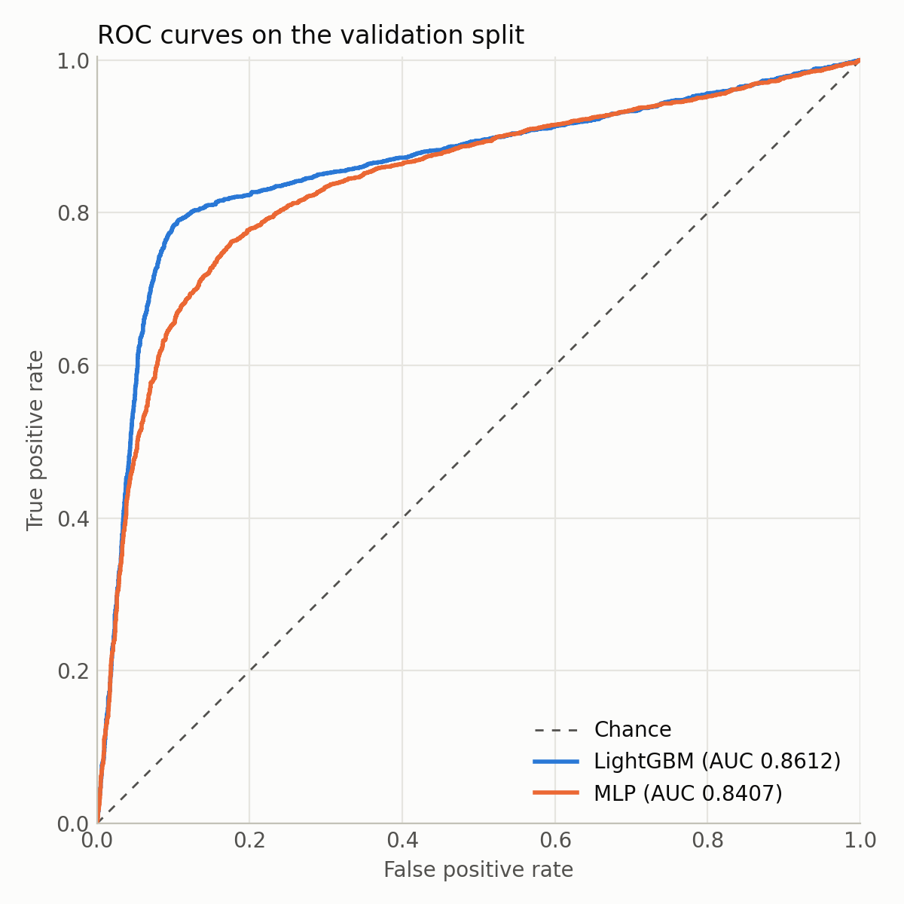

# 43030-ml-depth


Evidence for 43030 AT3, covering Goals 3 and 4. The repo has two machine learning projects with tests, CI and Docker:

- **Classifier:** a PyTorch MLP compared with my 31250 LightGBM model on loan default prediction, using the same train/validation split.
- **Recommender:** matrix factorisation trained with BPR, compared with a popularity baseline on MovieLens 100K.

## Results

### Classifier

Stratified 80/20 split, random_state 42: 28,000 train rows, 7,000 validation rows.

| Model | Validation AUC |
|---|---|
| LightGBM | 0.8612 |
| MLP | 0.8407 |

LightGBM beats the MLP on this data. The MLP's epoch was chosen on the validation split, so its AUC is slightly optimistic, which does not change the result.



### Recommender

MovieLens 100K, leave-last-out. Test users: **942**. Seed 42.

| Model | P@10 | R@10 | NDCG@10 |
|---|---|---|---|
| Popularity | 0.0058 | 0.0584 | 0.0289 |
| MF (dim 64, 20 epochs) | 0.0092 | 0.0924 | 0.0428 |

Each user has one relevant test item, so P@10 is R@10 divided by 10.

## How to run

Install the CPU build of PyTorch first, then the rest:

```
pip install torch --index-url https://download.pytorch.org/whl/cpu
pip install -r requirements.txt
```

Tests:

```
pytest --cov=src --cov-report=term-missing
```

Recommender:

```
python scripts/download_movielens.py
python -m src.recommender.evaluate
```

Classifier, once the loan dataset is in `data/`:

```
python -m src.classifier.lightgbm_baseline
python -m src.classifier.train
```

Docker runs the recommender:

```
docker build -t ml-depth . && docker run ml-depth
```

## Data

- **Loan default:** not included in this repo. It is the labelled training set from the private Kaggle competition for 31250 Introduction to Data Analytics, Assignment 3 (Loan Default Prediction), at UTS. Save it as `data/Assignment3-Loan-Dataset.csv`.
- **MovieLens 100K:** downloaded by `scripts/download_movielens.py` from GroupLens into `data/ml-100k/`.

## Project structure

```
43030-ml-depth/
├── README.md
├── requirements.txt
├── pytest.ini
├── Dockerfile
├── .gitignore                 # data/, __pycache__/, *.pt
├── .github/workflows/ci.yml
├── scripts/
│   └── download_movielens.py
├── src/
│   ├── __init__.py
│   ├── classifier/
│   │   ├── __init__.py
│   │   ├── data.py
│   │   ├── model.py
│   │   ├── lightgbm_baseline.py
│   │   └── train.py
│   └── recommender/
│       ├── __init__.py
│       ├── data.py
│       ├── model.py
│       ├── baseline.py
│       ├── metrics.py
│       └── evaluate.py
├── tests/
│   ├── test_metrics.py
│   ├── test_split.py
│   └── test_models.py
└── results/
    ├── classifier_results.md
    ├── roc_curve.png
    └── recommender_results.md
```
